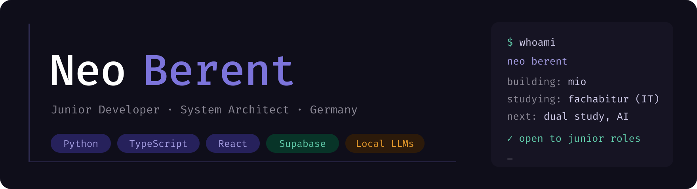
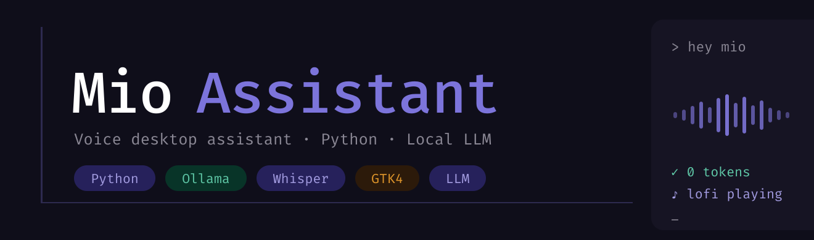
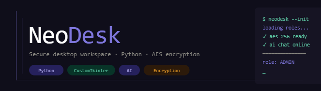
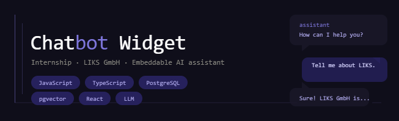
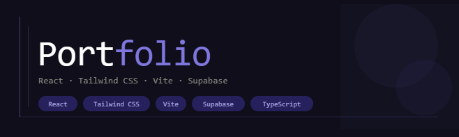

Hi, I'm Neo. I build things that work and actually make sense to use. Mostly Python and TypeScript, mostly
on Linux, and lately a lot of local AI. I'm finishing my Fachabitur with an IT focus, spent a year as an
intern at LIKS GmbH, and I'm heading into a dual study programme in Artificial Intelligence next.

### Projects

<table>
  <tr>
    <td width="50%" valign="top">
      
       <b><a href="https://github.com/neoberent/mio-assistant">Mio</a></b> 
      A voice assistant for my Linux desktop with a Live2D character. Local speech and a local LLM do
      almost everything; Claude only gets what they can't solve.
    </td>
    <td width="50%" valign="top">
      
       <b><a href="https://github.com/neoberent/NeoDesk">NeoDesk</a></b> 
      A desktop workspace in Python and CustomTkinter with role-based access, an AI chat, AES-encrypted
      notes and a full admin panel.
    </td>
  </tr>
  <tr>
    <td width="50%" valign="top">
      
       <b><a href="https://berent.dev/chatbot-widget">Enterprise Chatbot Widget</a></b> 
      Built during my internship at LIKS GmbH. One script tag puts a knowledge-grounded AI assistant on
      any website, backed by PostgreSQL and pgvector.
    </td>
    <td width="50%" valign="top">
      
       <b><a href="https://berent.dev">Portfolio</a></b> 
      berent.dev, built with React, Vite, Tailwind and Supabase Edge Functions. Has an AI chat that can
      also book a meeting with me.
    </td>
  </tr>
</table>

### What I work with

**Daily:** Python · TypeScript · React · Tailwind CSS · Supabase · PostgreSQL 
**AI:** Ollama · Whisper · tool calling · RAG with pgvector · LLM APIs 
**Setup:** CachyOS · niri · Git · systemd

### Get in touch

I'm looking for a dual study place in AI or computer science, ideally starting in 2027.
[berent.dev](https://berent.dev) · [LinkedIn](https://www.linkedin.com/in/neo-berent-757325397) · [Contact / book a meeting](https://berent.dev/contact)
